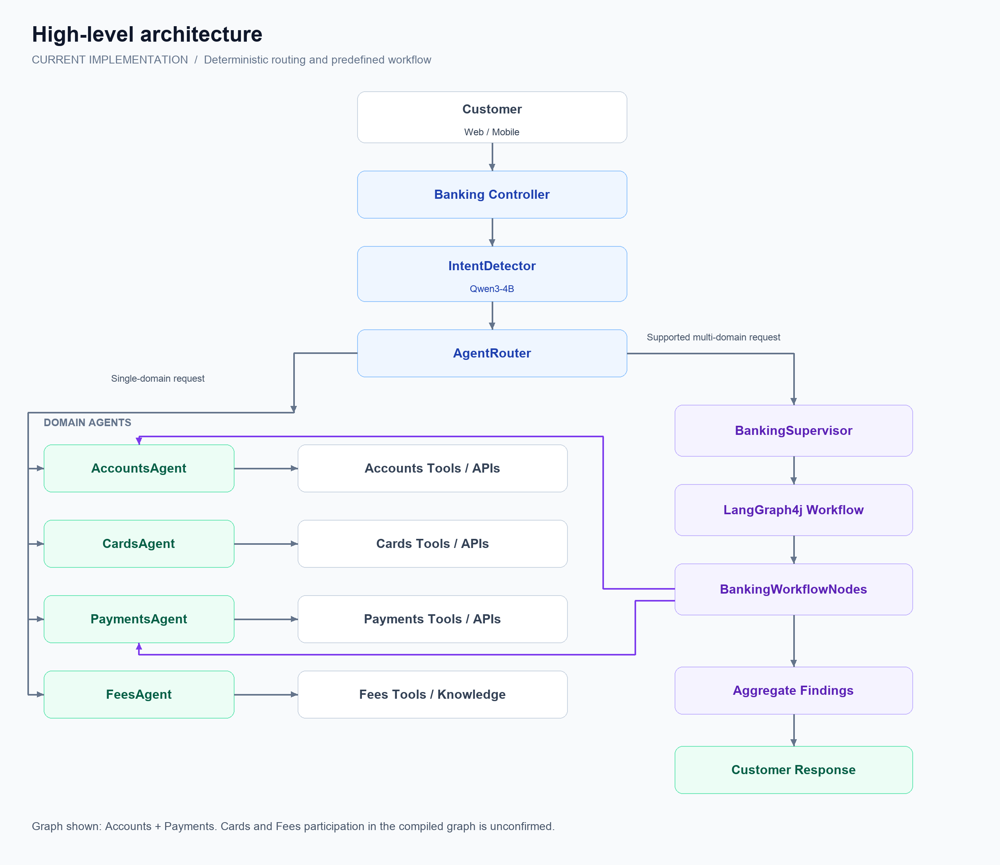
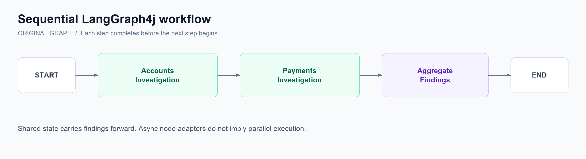
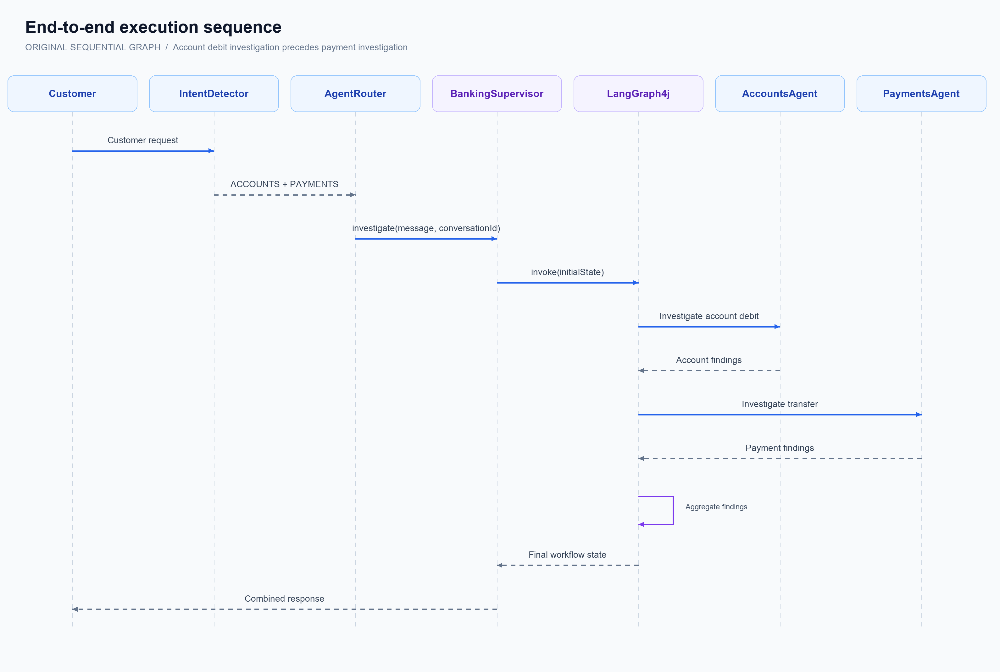
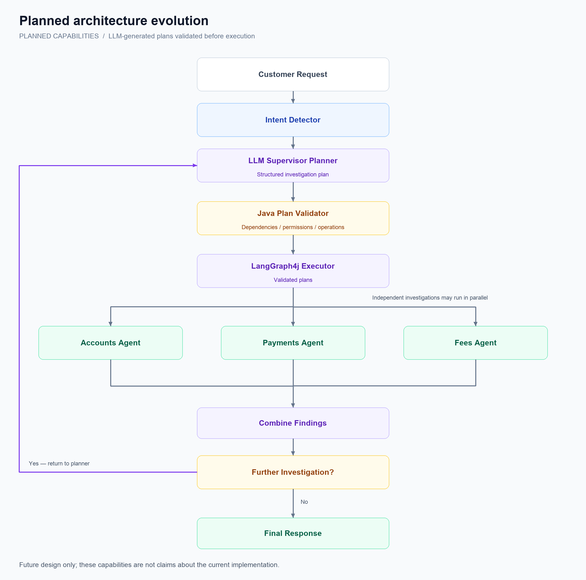

# AI Banking Assistant — Workflow Architecture and Implementation

**Technical Documentation | Current Implementation**

**Technology Stack:** Java 17 · Spring Boot 4.1.1 · Spring AI 2.0.1 · LangGraph4j 1.9.5 · Ollama · OpenAI · PostgreSQL · OpenTelemetry

## 1. Overview

The AI Banking Assistant is a multi-domain conversational banking system built with Spring AI and LangGraph4j.

The system receives customer questions, identifies the relevant banking domain, and delegates processing to specialized AI agents.

For requests involving multiple banking domains, a Supervisor coordinates a LangGraph4j workflow.

The architecture separates three responsibilities:

- **Intent Detection:** Understand what the customer needs.
- **Agent Routing:** Select the appropriate domain agent or multi-agent workflow.
- **Workflow Orchestration:** Execute the configured investigation steps and combine findings.

The current Supervisor is deterministic. It does not yet use an LLM to dynamically generate execution plans.

---

## 2. High-Level Architecture



The graph above represents the Accounts and Payments workflow from the latest shared node implementation. Fees and Cards are available as domain agents, but their participation in the compiled multi-agent graph has not been confirmed.

---

## 3. Main Components and Responsibilities

| Component | Responsibility |
|---|---|
| `IntentDetector` | Classifies requests using Qwen3-4B |
| `IntentResult` | Holds detected domains and clarification status |
| `AgentRouter` | Dispatches requests to agents or Supervisor |
| `AccountsAgent` | Handles account-related requests |
| `CardsAgent` | Handles card-related requests |
| `PaymentsAgent` | Handles payment investigations |
| `FeesAgent` | Handles fee-related requests |
| `BankingSupervisor` | Initializes and executes the graph |
| `BankingWorkflowConfig` | Defines graph nodes and execution paths |
| `BankingWorkflowState` | Shares information between nodes |
| `BankingWorkflowNodes` | Invokes domain agents and aggregates results |
| `WorkflowObservabilityService` | Records workflow traces, timing, and status |

---

## 4. Intent Detection

**Class:** `az.ingress.agentic.ai.training.services.IntentDetector`

The Intent Detector uses Qwen3-4B through Ollama to classify customer requests.

### Example

Customer asks:

*"My transfer failed, money was deducted, and I was charged an unexpected fee."*

Possible classification:

```json
{
  "intents": ["ACCOUNTS", "PAYMENTS", "FEES"],
  "requiresClarification": false
}
```

### Important Code

```java
IntentResult result = intentChatClient.prompt()
        .system("""
                Classify banking requests.

                ACCOUNTS: Balances, debits, credits.
                CARDS: Card status and management.
                PAYMENTS: Transfers and payment status.
                FEES: Banking charges and commissions.
                UNKNOWN: Unsupported requests.

                Identify all relevant domains.
                Do not answer the customer.
                """)
        .user(message)
        .call()
        .entity(IntentResult.class);
```

The actual classifier uses a more detailed system prompt and validates the structured response.

### Key Points

- Qwen3-4B identifies relevant domains.
- Multiple domains can be returned.
- Ambiguous requests can trigger clarification.
- The detector does not execute banking operations.
- Classification is probabilistic and must be validated.

---

## 5. Agent Routing

**Class:** `az.ingress.agentic.ai.training.services.AgentRouter`

The Agent Router receives the classification and selects an execution path.

### Single-Domain Requests

```java
return switch (intents.get(0)) {
    case ACCOUNTS -> accountsAgent.chat(message, conversationId);
    case CARDS -> cardsAgent.chat(message, conversationId);
    case PAYMENTS -> paymentsAgent.chat(message, conversationId);
    case FEES -> feesAgent.chat(message, conversationId);
    case UNKNOWN -> "Unsupported banking request.";
};
```

### Multi-Domain Requests

Supported multi-domain combinations are delegated to:

```java
bankingSupervisor.investigate(
        message,
        conversationId
);
```

The previously shared router used explicit domain-combination checks.

The router must not assume that every combination is supported simply because all individual agents exist.

### Key Points

- Routing is deterministic Java logic.
- Single-domain requests bypass LangGraph4j.
- Multi-domain requests use the Supervisor when supported.
- Unknown or ambiguous requests should not trigger arbitrary banking operations.

---

## 6. Banking Supervisor

**Class:** `az.ingress.agentic.ai.training.services.supervisor.BankingSupervisor`

The Supervisor is the entry point for multi-domain workflow execution.

Its current responsibilities are:

1. Validate the request.
2. Initialize the graph state.
3. Start LangGraph4j execution.
4. Retrieve the final response.
5. Delegate observability to a dedicated service.

### Current Implementation

```java
@Service
@RequiredArgsConstructor
public class BankingSupervisor {

    private final CompiledGraph<BankingWorkflowState> bankingWorkflow;
    private final WorkflowObservabilityService observability;

    public String investigate(
            String message,
            String conversationId) {

        validate(message, conversationId);

        return observability.traceWorkflow(
                () -> execute(message, conversationId)
        );
    }

    private String execute(
            String message,
            String conversationId) {

        var initialState = Map.<String, Object>of(
                BankingWorkflowState.QUESTION, message,
                BankingWorkflowState.CONVERSATION_ID, conversationId
        );

        var finalState = bankingWorkflow.invoke(initialState)
                .orElseThrow();

        return finalState.finalResponse()
                .orElseThrow();
    }
}
```

The production class also validates inputs and provides descriptive exceptions.

### Important Architectural Detail

The current `BankingSupervisor` receives only:

- `message`
- `conversationId`

It does not receive the detected domains from `IntentDetector`.

Therefore, the Supervisor cannot independently use the detector's domain list to select graph nodes.

**The current Supervisor is a workflow coordinator, not an LLM-powered planning agent.**

---

## 7. LangGraph4j Workflow

**Class:** `BankingWorkflowConfig`

LangGraph4j defines how workflow nodes are connected and executed.

Our original graph follows this structure:



### Important Code

```java
return new StateGraph<>(BankingWorkflowState::new)
        .addNode(
                "accounts",
                node_async(nodes::investigateAccounts)
        )
        .addNode(
                "payments",
                node_async(nodes::investigatePayments)
        )
        .addNode(
                "aggregate",
                node_async(nodes::aggregate)
        )
        .addEdge(START, "accounts")
        .addEdge("accounts", "payments")
        .addEdge("payments", "aggregate")
        .addEdge("aggregate", END)
        .compile();
```

This represents the original sequential graph. The latest `BankingWorkflowConfig` source should be checked to confirm the currently compiled topology.

### Execution Characteristics

- Nodes are defined in Java.
- Edges control execution order.
- Each node receives shared workflow state.
- Nodes return state updates.
- LangGraph4j executes the compiled graph.

The original workflow is sequential. An asynchronous node adapter does not automatically mean that agents execute in parallel.

---

## 8. Shared Workflow State

**Class:** `BankingWorkflowState`

The shared state stores information needed during the investigation.

### Key Fields

```java
public static final String QUESTION = "question";
public static final String CONVERSATION_ID = "conversationId";

public static final String ACCOUNT_RESULT = "accountResult";
public static final String PAYMENT_RESULT = "paymentResult";

public static final String FINAL_RESPONSE = "finalResponse";
```

### Example

The Accounts node returns:

```java
return Map.of(
        BankingWorkflowState.ACCOUNT_RESULT,
        result
);
```

LangGraph4j applies the update to shared state.

The Payments node can then access:

```java
state.accountResult()
```

The Aggregation node accesses the collected findings and produces the final response.

### Workflow State vs. Conversation Memory

| Workflow State | Conversation Memory |
|---|---|
| Stores current investigation findings | Stores conversational messages |
| Shared between graph nodes | Used by Spring AI chat advisors |
| Scoped to workflow execution | Scoped to a conversation |
| Used for orchestration decisions | Used for conversational continuity |

These are separate concerns.

---

## 9. Banking Workflow Nodes

**Class:** `BankingWorkflowNodes`

This class contains the Java methods executed by LangGraph4j.

### Accounts Investigation

```java
public Map<String, Object> investigateAccounts(
        BankingWorkflowState state) {

    return observationService.observe(
            "accounts",
            () -> {
                String result = accountsAgent.chat(
                        """
                        Investigate the account debit.
                        Report only verified information.
                        Do not infer settlement from a debit.

                        Customer request:
                        %s
                        """.formatted(state.question()),
                        state.conversationId()
                );

                return Map.of(
                        BankingWorkflowState.ACCOUNT_RESULT,
                        result
                );
            }
    );
}
```

### Payments Investigation

The Payments node investigates transfer status and processing events.

In the latest shared implementation, it also receives the Accounts Agent's findings:

```java
String result = paymentsAgent.chat(
        """
        Investigate transfer status and processing events.

        Customer request:
        %s

        Account investigation:
        %s
        """.formatted(
                state.question(),
                state.accountResult().orElse(
                        "No account findings available"
                )
        ),
        state.conversationId()
);
```

This creates a dependency between Accounts and Payments in that implementation.

### Aggregation

```java
String response = """
        Banking investigation:

        Account findings:
        %s

        Payment findings:
        %s

        No refund or reversal has been initiated.
        """.formatted(
        state.accountResult().orElse("Unavailable"),
        state.paymentResult().orElse("Unavailable")
);
```

The Aggregator combines findings without executing financial operations.

---

## 10. End-to-End Execution Example

### Customer Request

*"I transferred 500 AZN. The money was deducted, but the recipient hasn't received it."*

### Execution



This example illustrates the original sequential graph. Actual findings depend on the banking tools and available records.

An account debit does not independently prove payment settlement. A payment timeout does not necessarily mean the transfer failed.

---

## 11. Observability and Monitoring

The application uses:

- Micrometer Observation
- OpenTelemetry
- OpenTelemetry Collector
- Grafana Tempo
- Prometheus
- Grafana

### Observation Names

| Observation | Purpose |
|---|---|
| `banking.intent.detect` | Intent classification |
| `banking.workflow.execution` | Overall Supervisor workflow |
| `banking.workflow.node` | Individual graph nodes |

### Workflow Observability

**Class:** `WorkflowObservabilityService`

The Supervisor delegates monitoring through:

```java
return observability.traceWorkflow(
        () -> execute(message, conversationId)
);
```

The observability service records a workflow ID, execution timing, completion status, and failures.

### Example Trace

```text
HTTP /banking/chat
├── banking.intent.detect
│   └── Qwen3-4B
└── banking.workflow.execution
    ├── banking.workflow.node [accounts]
    ├── banking.workflow.node [payments]
    └── banking.workflow.node [aggregate]
```

The exact parent-child structure depends on trace-context propagation.

Grafana Tempo is used to inspect individual executions, while Prometheus provides aggregated metrics such as workflow counts and latency.

Observability does not automatically provide a complete, durable audit history of customer messages and final answers.

---

## 12. Current Limitations

### 12.1 No Intelligent Supervisor Planning

The Supervisor does not currently ask an LLM to decide:

- Which agents should execute.
- Whether tasks should run sequentially or in parallel.
- Whether additional investigation is necessary.

These decisions are controlled by routing rules and the compiled graph.

### 12.2 Detected Intents Are Not Passed to the Supervisor

The latest shared Supervisor initializes only the customer question and conversation ID.

Dynamic graph routing based on detected intents requires an explicit contract change.

### 12.3 Parallel Execution Is Not Confirmed

The original graph executes Accounts before Payments.

A proposed parallel graph was discussed, but its implementation has not been verified.

### 12.4 Agent Findings Are Text-Based

Domain agents currently return natural-language findings.

Structured results would make branching, validation, and aggregation more reliable.

### 12.5 Shared Conversation Memory

Domain agents may use the same conversation ID.

Concurrent agent execution will require careful memory isolation to avoid inconsistent histories.

### 12.6 Persistent Workflow Recovery

Durable checkpointing, interruption/resumption, and human approval have not been confirmed as implemented.

---

## 13. Planned Architecture Evolution

The next stage introduces an LLM-powered Supervisor with validated execution plans.



The planned components include:

1. **Supervisor Planner:** Generates a structured investigation plan.
2. **Execution Plan Validator:** Checks dependencies, permissions, and supported operations.
3. **Graph Executor:** Executes validated plans.
4. **Parallel Execution:** Runs independent investigations concurrently.
5. **Conditional Replanning:** Requests additional evidence when necessary.
6. **Human Approval:** Protects sensitive banking operations.
7. **Checkpointing:** Supports recovery and resumption.
8. **Workflow Audit:** Records business decisions and investigation outcomes.

These are future capabilities, not claims about the current implementation.

---

## 14. Key Architectural Principles

**Separation of Responsibilities:** Intent detection, routing, orchestration, and banking operations remain separate.

**Deterministic Execution:** LangGraph4j follows explicitly defined graph transitions.

**Authoritative Data:** Banking services, not LLM-generated text, determine financial facts.

**Least Privilege:** Agents should only access tools appropriate to their responsibilities.

**Observability:** Workflow execution should be traceable from request to response.

**Controlled Autonomy:** Future LLM-generated plans must be validated before execution.

---

## Summary

Our current Banking Assistant demonstrates the foundations of a multi-agent architecture.

It combines domain-specific AI agents, Qwen3-4B intent classification, deterministic Java routing, LangGraph4j workflow execution, shared state, and OpenTelemetry observability.

**The current Supervisor starts and monitors a predefined workflow. It is not yet an intelligent planning agent.**

The next architectural milestone is to introduce a Supervisor capable of proposing execution plans, while Java validates those plans and LangGraph4j executes them safely.