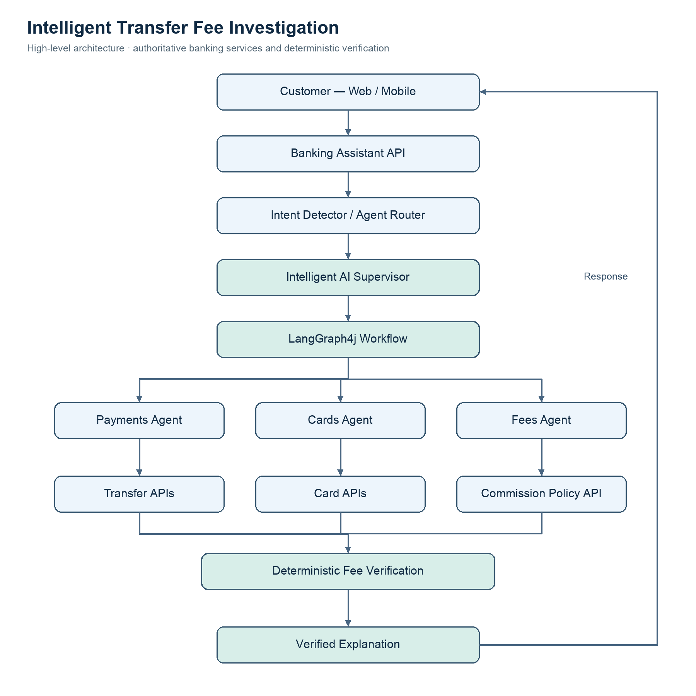
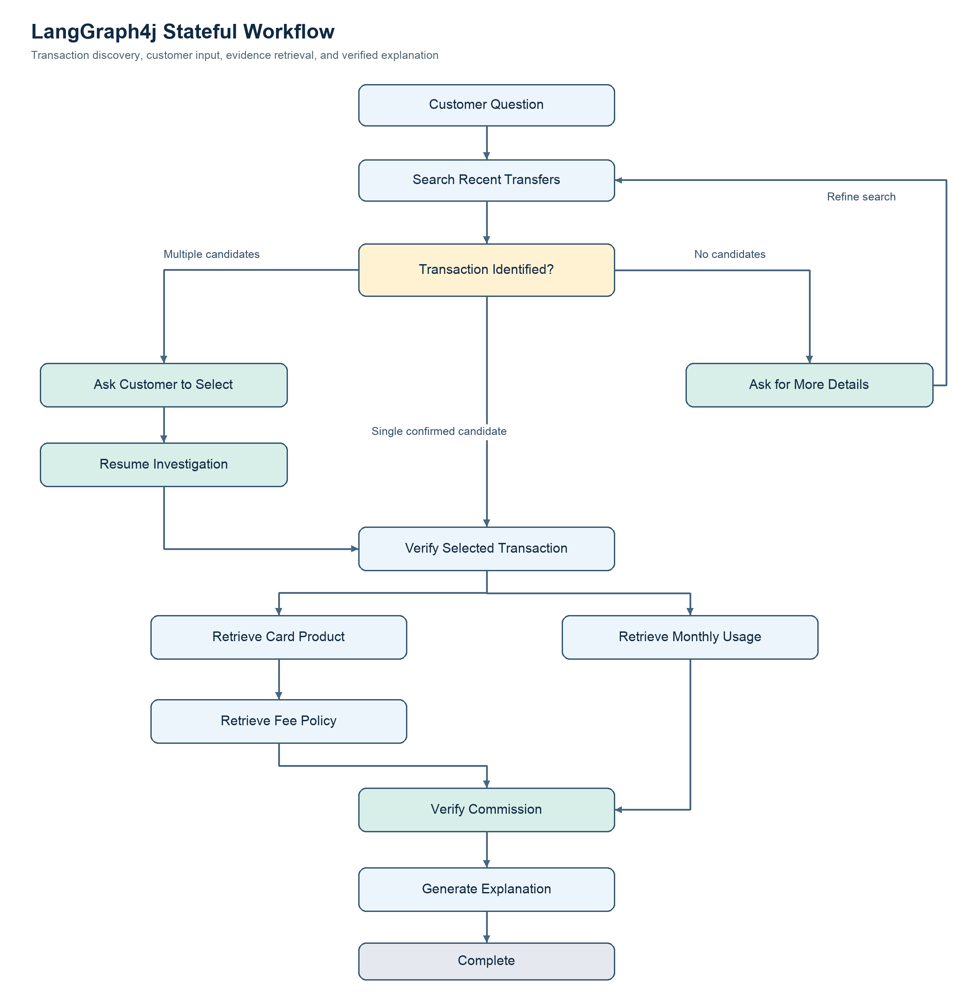

# Intelligent Transfer Fee Investigation

**AI Banking Assistant — Practical Multi-Agent Workflow**

**Status:** Planned Implementation  
**Technology:** Java 17 · Spring Boot 4 · Spring AI · LangGraph4j · PostgreSQL · OpenTelemetry  
**Repository location:** `docs/use-cases/intelligent-transfer-fee-investigation.md`

---

## 1. Overview

We are building an AI Banking Assistant that can investigate customer complaints about unexpected transfer commissions.

Unlike a traditional chatbot that provides generic answers about banking fees, our assistant will identify the customer's actual transaction, retrieve relevant banking information, verify the applicable commission rules, and explain why the fee was charged.

The assistant must also handle incomplete customer requests.

For example, a customer may ask:

> "I made a transfer recently, and the bank charged me a commission. Why?"

The customer may not remember the transaction ID, exact amount, or date.

Instead of immediately failing or asking for a transaction reference, the assistant should help identify the transaction from the customer's recent banking activity.

Once the transaction is identified, multiple specialized AI agents collaborate to investigate the charge.

**Our goal is to demonstrate how an intelligent Supervisor, domain-specific agents, and LangGraph4j can solve a realistic banking problem through a controlled, stateful workflow.**

---

## 2. Business Scenario

Our fictional bank supports multiple card products, domestic transfers, and international transfers.

Customers may have several cards, each with different transfer limits and commission policies.

Some transfers are free, while others incur charges depending on the card product, transfer type, cumulative monthly usage, and applicable tariff.

### 2.1 Customer Cards

| Card | Product | Monthly free transfer allowance |
|---|---|---:|
| Visa Classic ••1234 | Standard | 1,000 AZN |
| Mastercard Gold ••5678 | Gold | 3,000 AZN |
| Visa Platinum ••9012 | Premium | 5,000 AZN |

These are fictional banking products and limits created for the training scenario.

### 2.2 Recent Transactions

| Date | Card | Transfer amount | Commission |
|---|---|---:|---:|
| October 20 | ••1234 | 300 AZN | 0 AZN |
| October 21 | ••5678 | 1,200 AZN | 0 AZN |
| October 22 | ••1234 | 500 AZN | 0 AZN |
| October 24 | ••1234 | 700 AZN | 7 AZN |
| October 25 | ••9012 | 2,000 AZN | 0 AZN |

The customer notices the 7 AZN commission on October 24 and contacts the bank.

---

## 3. Customer Interaction

The conversation should feel natural and require minimal technical knowledge from the customer.

### Step 1 — Initial Question

**Customer:**

> "Why was I charged a commission on my recent transfer?"

The request does not identify a specific transaction.

The assistant must determine which transfer the customer is referring to.

### Step 2 — Transaction Discovery

**Banking Assistant:**

> "I found several recent transfers. Could you select the one you're asking about?"

| Date | Amount | Card | Fee |
|---|---:|---|---:|
| October 24 | 700 AZN | ••1234 | 7 AZN |
| October 22 | 500 AZN | ••1234 | 0 AZN |
| October 21 | 1,200 AZN | ••5678 | 0 AZN |

The assistant may rank transactions with commissions first because they are more relevant to the customer's question.

However, the customer must confirm the transaction before the investigation proceeds.

If no suitable transaction is found, the assistant can ask for an approximate amount, date, or recipient.

### Step 3 — Customer Selection

**Customer:**

> "The 700 AZN transfer."

The system identifies the selected transaction using an internal transaction identifier associated with the authenticated customer.

### Step 4 — Investigation

The assistant retrieves:

- The selected transfer and its recorded commission.
- The source card and card product.
- The applicable fee policy.
- Previous eligible transfers during the relevant monthly period.
- The remaining free transfer allowance before the selected transaction.

The Supervisor coordinates the relevant domain agents and evaluates whether the collected information is sufficient.

### Step 5 — Final Explanation

**Banking Assistant:**

> "Your 700 AZN transfer on October 24 was charged a 7 AZN commission because your Visa Classic card had already used 800 AZN of its 1,000 AZN monthly free transfer allowance.
>
> You had only 200 AZN remaining. Since the transfer exceeded that allowance, the applicable tariff charged 1% of the full 700 AZN transfer, resulting in a 7 AZN commission.
>
> Based on the verified transaction history and tariff, the charge was calculated correctly."

This is the expected response for our fictional training data.

---

## 4. Commission Calculation Rules

We will implement a simplified but deterministic fee policy for the training scenario.

### Visa Classic — Domestic Transfers

| Rule | Value |
|---|---|
| Monthly free allowance | 1,000 AZN |
| Monthly period | Calendar month |
| Eligible transfers | Completed domestic card-funded transfers |
| Commission when allowance is exceeded | 1% of the full new transfer |
| Currency | AZN |
| Rounding | Two decimal places, HALF_UP |

A transfer is free when its amount fits entirely within the remaining allowance.

If the new transfer exceeds the remaining allowance, the commission applies to the full transfer amount, not only the excess.

This is a deliberately simplified fictional policy.

### Calculation Example

Previous eligible transfers:

```text
October 20: 300 AZN
October 22: 500 AZN

Previously used allowance: 800 AZN
Monthly allowance:        1,000 AZN
Remaining allowance:        200 AZN

New transfer:               700 AZN
```

The new transfer exceeds the remaining allowance.

```text
Commission = 700 × 1%
Commission = 7 AZN
```

The system should retrieve the policy effective on the transaction date. The policy engine must also define how reversed transactions, pending transfers, excluded transfer categories, and currency conversions affect the allowance.

For the first implementation, international transfers will use separate mock tariff rules and will not consume the domestic free allowance.

**Important:** Commission calculations must be performed by deterministic Java services, not by relying on an LLM's arithmetic or interpretation alone.

---

## 5. High-Level Architecture

The system contains an intent detection layer, a high-level router, an intelligent Supervisor, specialized agents, and banking services.



The Supervisor is responsible for planning and coordinating the investigation.

LangGraph4j executes the validated workflow, manages shared state, and supports conditional transitions and resumption.

Banking services remain authoritative for transaction data and financial calculations.

---

## 6. Domain Agents and Responsibilities

### Payments Agent

The Payments Agent is responsible for discovering and investigating transfers.

It can retrieve recent transactions, search by amount and date, identify the selected transaction, and retrieve eligible monthly transfer history.

Example tools:

```java
List<Transfer> findRecentTransfers(
        TransferSearchCriteria criteria);

Transfer getTransfer(String transactionId);

TransferUsage getMonthlyTransferUsage(
        String cardId,
        YearMonth month);
```

Customer identity must come from the authenticated session or trusted execution context, not from an arbitrary ID generated by the LLM.

### Cards Agent

The Cards Agent retrieves the source card and its product information.

Example tools:

```java
List<Card> getCustomerCards();

Card getCard(String cardId);
```

The Card API should return the card product and other attributes required for tariff selection, without exposing full card numbers.

### Fees Agent

The Fees Agent retrieves applicable tariff information.

It determines which fee policy applies to the selected card product, transfer type, and transaction date.

Example tools:

```java
FeePolicy getApplicableFeePolicy(
        String cardProduct,
        String transferType,
        LocalDate transactionDate);
```

The Fees Agent does not independently authorize refunds or modify transaction records.

### Intelligent Supervisor

The Supervisor coordinates the investigation.

It determines which information is missing, selects the required agents, proposes dependencies, and decides whether further investigation or customer clarification is needed.

Its execution plans must be validated by Java before being executed.

---

## 7. LangGraph4j Workflow

This scenario introduces a stateful, multi-turn workflow.

The assistant must be able to pause when customer input is required and continue after receiving that input.



### Workflow Patterns Demonstrated

| Pattern | Application |
|---|---|
| Conditional routing | Determine whether the transaction is identified |
| Human-in-the-Loop | Customer selects a transaction |
| Checkpointing | Persist investigation while waiting for customer input |
| Supervisor orchestration | Coordinate Cards, Payments, and Fees |
| Parallel execution | Retrieve independent information concurrently |
| Sequential execution | Calculate commission after collecting required evidence |
| Iteration | Refine transaction search when necessary |

The customer selection is a human-input step, not an authorization to perform a financial operation.

---

## 8. Workflow State Management

LangGraph4j needs to maintain the investigation context between steps.

Example conceptual state:

```java
public class TransferFeeInvestigationState extends AgentState {

    // Customer question and investigation identity
    // Search criteria and candidate transactions
    // Selected transaction ID
    // Card product and transfer type
    // Applicable fee policy
    // Monthly eligible transfer usage
    // Expected and actual commission
    // Current workflow status
    // Final explanation
}
```

### Important State Transitions

| State | Meaning |
|---|---|
| `STARTED` | Investigation initialized |
| `SEARCHING_TRANSACTIONS` | Finding relevant transfers |
| `WAITING_FOR_SELECTION` | Waiting for customer input |
| `INVESTIGATING` | Domain agents retrieving evidence |
| `VERIFYING_FEE` | Deterministic commission calculation |
| `COMPLETED` | Explanation generated |
| `ESCALATED` | Human support required |
| `FAILED` | Workflow could not complete |

When the assistant presents transaction candidates, the workflow must preserve the candidate list and associate the customer's selection with a trusted candidate identifier.

On resumption, the system must revalidate that the transaction belongs to the authenticated customer.

---

## 9. Banking APIs and Mock Data

For the training project, we will use mock banking services with consistent, deterministic data.

### Transfer API

Returns transfer details such as:

```json
{
  "transactionId": "TX-1004",
  "cardId": "CARD-1234",
  "amount": 700.00,
  "currency": "AZN",
  "transferType": "DOMESTIC",
  "transactionDate": "2026-10-24",
  "status": "COMPLETED",
  "chargedFee": 7.00
}
```

### Card API

```json
{
  "cardId": "CARD-1234",
  "maskedPan": "****1234",
  "productType": "VISA_CLASSIC",
  "status": "ACTIVE"
}
```

### Commission Policy API

```json
{
  "policyId": "DOMESTIC-CLASSIC-2026",
  "cardProduct": "VISA_CLASSIC",
  "transferType": "DOMESTIC",
  "currency": "AZN",
  "monthlyFreeAllowance": 1000.00,
  "commissionRate": 0.01,
  "chargeBasis": "FULL_TRANSFER_IF_LIMIT_EXCEEDED",
  "effectiveFrom": "2026-01-01"
}
```

### Monthly Usage API

```json
{
  "cardId": "CARD-1234",
  "period": "2026-10",
  "eligibleUsageBeforeTransaction": 800.00,
  "currency": "AZN"
}
```

All monetary calculations should use `BigDecimal`, explicit currency handling, and consistent rounding rules.

---

## 10. Deterministic Fee Verification

The fee calculation service must independently reproduce the commission charged by the bank.

Its responsibilities include determining the applicable policy, evaluating the remaining allowance, calculating the expected commission, and comparing the result with the recorded charge.

### Example

```java
BigDecimal remainingAllowance =
        monthlyAllowance.subtract(previousUsage);

BigDecimal expectedFee =
        transferAmount.compareTo(remainingAllowance) > 0
                ? transferAmount.multiply(commissionRate)
                    .setScale(2, RoundingMode.HALF_UP)
                : BigDecimal.ZERO.setScale(2);
```

This simplified example assumes that the correct policy, eligible usage, currency, and transaction status have already been verified.

The result should contain structured evidence, not just a text explanation.

For example:

```json
{
  "expectedFee": 7.00,
  "actualFee": 7.00,
  "currency": "AZN",
  "matchesPolicy": true,
  "reasonCode": "MONTHLY_ALLOWANCE_EXCEEDED"
}
```

The LLM can then translate these verified facts into a customer-friendly explanation.

---

## 11. Handling Alternative Scenarios

The workflow must handle more than the happy path.

| Scenario | Expected behavior |
|---|---|
| Customer doesn't know transaction ID | Search recent transactions |
| Multiple matching transfers | Ask customer to select |
| No matching transfer | Ask for approximate date, amount, or recipient |
| Customer selects another customer's transaction | Reject access |
| Transaction is pending | Avoid assuming final settlement or fee eligibility |
| Applicable tariff cannot be retrieved | Do not invent a commission rule |
| Policy changed after transaction | Use the policy effective at transaction time |
| Charged fee differs from expected fee | Flag discrepancy for review |
| Customer asks for refund | Route to a separately authorized workflow |
| External API unavailable | Retry safely or escalate |
| Customer abandons conversation | Preserve or expire the workflow according to policy |

The assistant should distinguish between a verified correct fee, a verified discrepancy, and an investigation that cannot be completed because evidence is missing.

---

## 12. Security and Reliability

Because this is a banking scenario, AI decisions must remain inside controlled boundaries.

The implementation must enforce authenticated customer identity, transaction ownership, least-privilege tools, and secure handling of card information.

The LLM must not receive full card numbers, passwords, or unnecessary personal data.

Read-only investigation tools should be separated from tools that perform financial operations.

Workflow resumption must use authenticated sessions and trusted candidate identifiers. A customer must not be able to select a transaction by submitting an arbitrary transaction ID.

API calls should have timeouts, controlled retries, and appropriate failure handling.

No refund, reversal, or card modification should occur during this investigation workflow.

---

## 13. Observability and Auditability

We will reuse the project's existing OpenTelemetry, Grafana Tempo, and Prometheus infrastructure.

Each investigation should be traceable across:

```text
Customer Request
  → Intent Detection
  → Supervisor Planning
  → Transaction Discovery
  → Customer Clarification
  → Workflow Resumption
  → Domain Agent Execution
  → Fee Verification
  → Final Explanation
```

Important metadata includes:

- Workflow ID and trace correlation.
- Selected agents and execution dependencies.
- Transaction discovery and selection status.
- Execution stage durations.
- Banking API and tool-call outcomes.
- Fee verification result.
- Final workflow status.

Sensitive customer data should not be recorded as ordinary trace attributes.

For durable investigation history, the system should persist business audit records separately from Tempo traces.

---

## 14. Implementation Roadmap

We will implement the scenario incrementally.

### Phase 1 — Banking Domain Simulation

Create mock card, transfer, monthly usage, and commission policy APIs.

Populate the database with realistic, internally consistent test data.

### Phase 2 — Transaction Discovery

Implement recent-transfer retrieval and matching based on the customer's question.

Allow the assistant to present likely candidate transactions.

### Phase 3 — Clarification and Workflow Resumption

Introduce LangGraph4j checkpointing and customer transaction selection.

Resume the existing investigation instead of restarting it.

### Phase 4 — Multi-Agent Investigation

Connect Payments, Cards, and Fees agents to the intelligent Supervisor.

Execute independent investigations concurrently and enforce dependencies.

### Phase 5 — Commission Verification

Implement deterministic fee calculation and comparison with the recorded commission.

### Phase 6 — Customer Explanation

Generate one concise, evidence-based explanation using the verified investigation results.

### Phase 7 — Monitoring and Testing

Verify execution traces, failure handling, workflow recovery, and business correctness.

---

## 15. Acceptance Criteria

The implementation is complete when:

- A customer can ask about a recent commission without knowing the transaction ID.
- The assistant can retrieve and present relevant transactions.
- The customer can select a transaction safely.
- The workflow preserves its state between customer messages.
- The Supervisor coordinates the necessary domain agents.
- The system retrieves the correct card product, transaction history, and applicable tariff.
- The Java fee calculator reproduces the expected commission.
- The final response explains the reason for the charge using verified facts.
- Missing or conflicting evidence leads to clarification or escalation, not fabricated conclusions.
- The investigation can be inspected end to end through observability and audit records.

---

## 16. Expected Outcome

At the end of this implementation, our AI Banking Assistant will be capable of investigating an ambiguous customer complaint through a multi-step conversation.

The customer will not need to understand transaction IDs, banking tariffs, monthly allowances, or internal banking services.

The system will discover the relevant transaction, coordinate specialized agents, verify the commission, and explain the result clearly.
