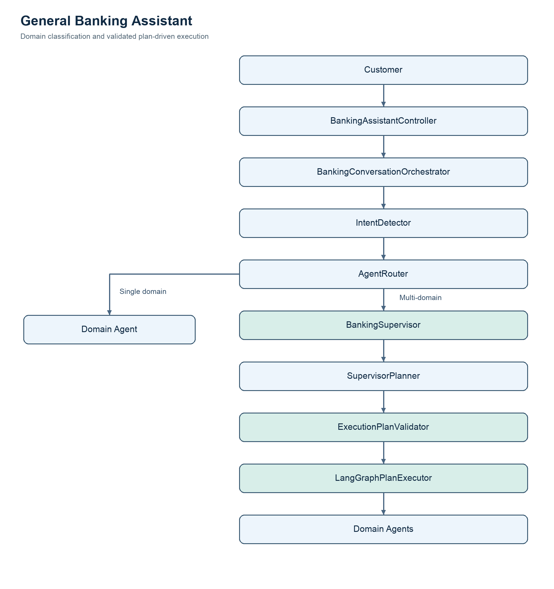
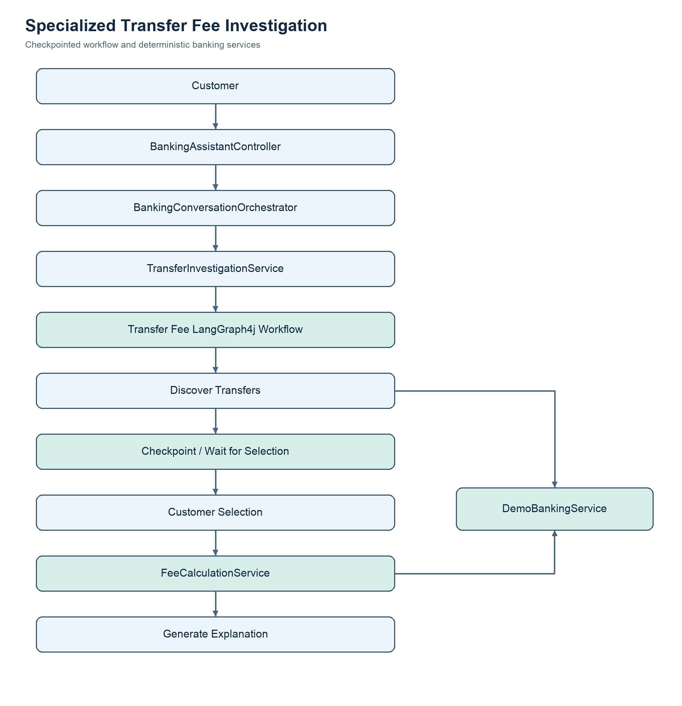
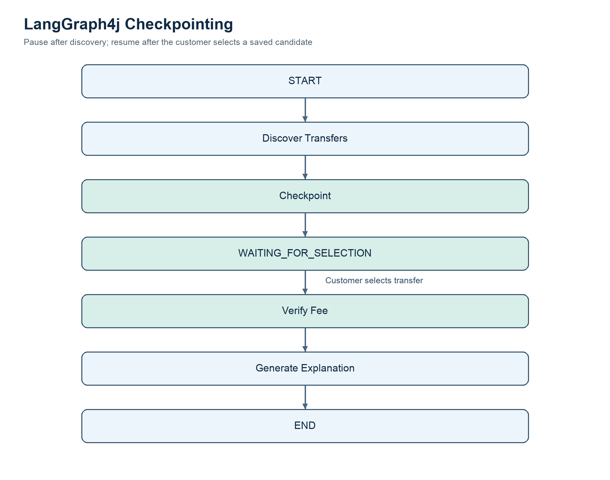
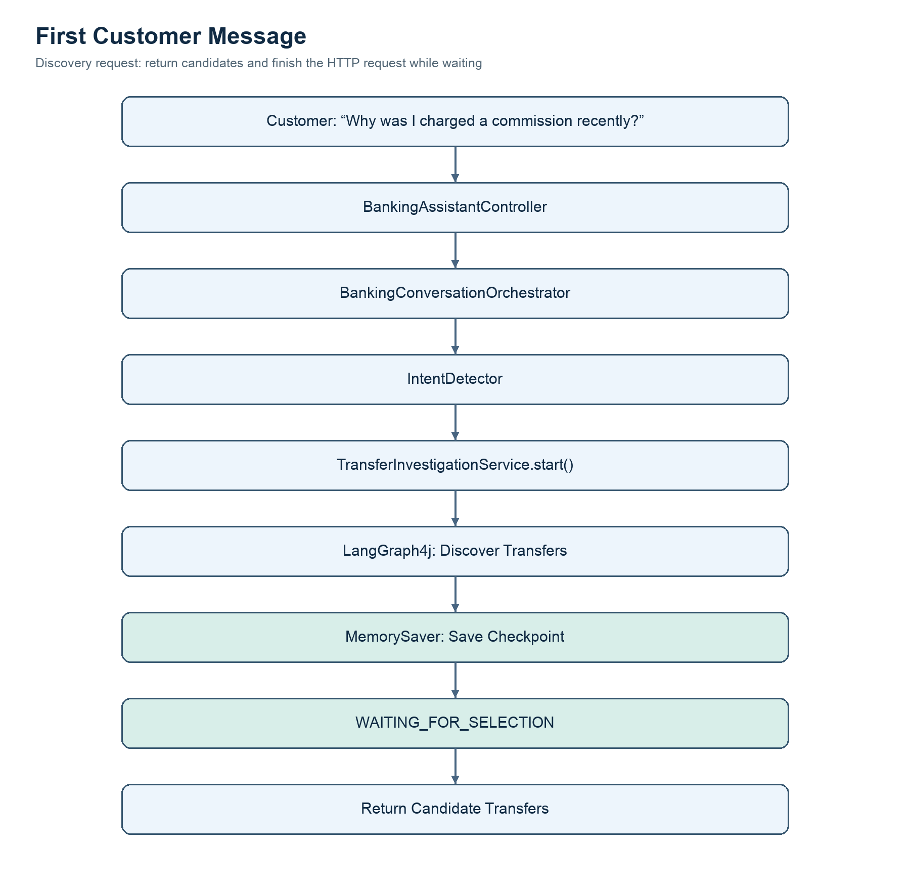
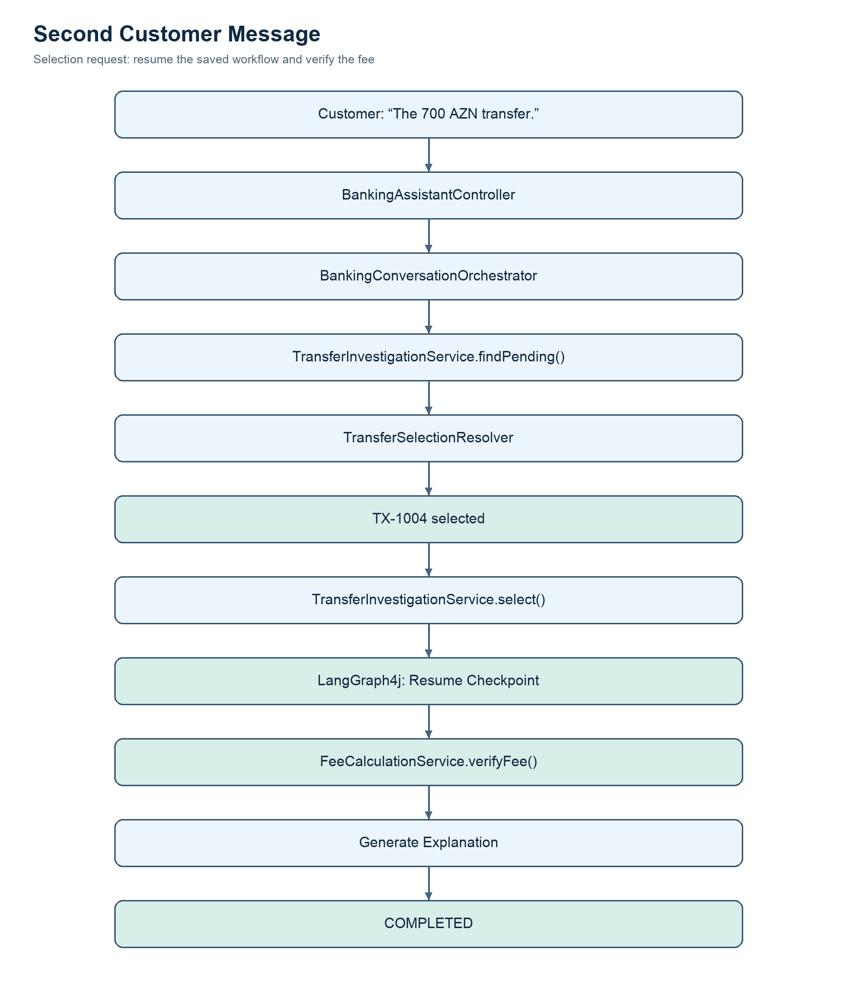

# Intelligent Transfer Fee Investigation

## Architecture, Components, and End-to-End Execution

**Project:** AI Banking Assistant  
**Technology:** Java 17, Spring Boot 4, Spring AI 2.0.1, LangGraph4j 1.9.5, OpenTelemetry, Grafana Tempo  
**Status:** Implemented demo with in-memory checkpointing  
**Repository location:** `docs/use-cases/transfer-fee-workflow-architecture.md`

---

## 1. Introduction

The Intelligent Transfer Fee Investigation demonstrates how a banking assistant can investigate an unexpected transfer commission through a multi-turn conversation.

A customer does not need to know the transaction ID or understand the bank's fee policies.

Instead, the assistant discovers recent transfers, asks the customer to identify the relevant transaction, resumes the investigation, verifies the commission using deterministic banking logic, and explains the result.

This scenario combines conversational AI, banking domain services, LangGraph4j workflow orchestration, checkpointing, customer interaction, and observability.

### Business Objective

Enable customers to understand why a commission was charged without requiring immediate intervention from a bank support representative.

### Example Customer Question

> "Why was I charged a commission on my recent transfer?"

The assistant should:

1. Find the customer's recent transfers.
2. Present possible transactions.
3. Wait for the customer to select one.
4. Resume the investigation.
5. Verify the applicable commission.
6. Explain the result using verified banking information.

---

## 2. System Architecture

The application contains two related but separate orchestration paths.

### 2.1 General Banking Assistant



The general banking architecture supports domain classification and plan-driven execution.

The LLM Supervisor proposes tasks and dependencies. Java validates the plan, and LangGraph4j executes the resulting workflow.

### 2.2 Specialized Transfer Fee Investigation



This specialized workflow currently uses deterministic Java services and a checkpointed LangGraph4j graph.

It does not require an LLM call for every step.

---

## 3. Main Components

| Component | Responsibility |
|---|---|
| `BankingAssistantController` | HTTP entry point for chatbot messages |
| `BankingConversationOrchestrator` | Determines whether to resume an investigation or route a new request |
| `IntentDetector` | Identifies relevant banking domains |
| `AgentRouter` | Dispatches ordinary banking requests |
| `BankingSupervisor` | Coordinates general multi-agent investigations |
| `SupervisorPlanner` | Generates LLM-based execution plans |
| `ExecutionPlanValidator` | Validates planned tasks and dependencies |
| `LangGraphPlanExecutor` | Executes validated plans |
| `TransferInvestigationService` | Starts and resumes transfer-fee investigations |
| `TransferSelectionResolver` | Matches customer replies to candidate transactions |
| `TransferFeeWorkflowState` | Stores structured investigation state |
| `TransferFeeWorkflowConfig` | Defines checkpointed graph execution |
| `TransferFeeWorkflowNodes` | Performs workflow operations |
| `DemoBankingService` | Provides mock banking data |
| `FeeCalculationService` | Calculates and verifies commissions |
| `DemoBankingTools` | Exposes mock banking data through Spring AI tools |
| `DemoFeeTools` | Exposes deterministic fee verification |
| `WorkflowObservabilityService` | Records general workflow execution metrics and traces |

---

## 4. Chatbot Entry Point

**Class:** `BankingAssistantController`

**Package:** `az.ingress.agentic.ai.training.controller`

The controller receives customer messages through:

```http
GET /banking/chat
```

Example:

```http
GET /banking/chat?conversationId=fee-001&message=Why%20was%20I%20charged%20a%20commission%20recently?
```

### Important Code

```java
@GetMapping("/chat")
public String chat(
        @RequestParam String message,
        @RequestParam String conversationId) {

    if (message == null || message.isBlank()
            || conversationId == null || conversationId.isBlank()) {
        throw new ResponseStatusException(
                HttpStatus.BAD_REQUEST,
                "message and conversationId must not be blank"
        );
    }

    return orchestrator.chat(message, conversationId);
}
```

The controller does not implement banking logic. It delegates conversation processing to `BankingConversationOrchestrator`.

---

## 5. Conversation Orchestration

**Class:** `BankingConversationOrchestrator`

This component decides how each customer message should be handled.

### Decision Process

First, it checks whether the conversation has an investigation waiting for customer input.

If an investigation is pending, the customer's message is treated as a potential response to the previous question.

If no investigation is pending, the request is classified and routed normally.

### Important Code

```java
public String chat(String message, String conversationId) {

    var pending = investigationService.findPending(conversationId);

    if (pending.isPresent()) {

        var investigation = pending.get();

        var transactionId = selectionResolver.resolve(
                message,
                investigation.candidates()
        );

        if (transactionId.isEmpty()) {
            return "Please clarify which transfer you mean.";
        }

        return investigationService.select(
                investigation.investigationId(),
                conversationId,
                transactionId.get()
        ).message();
    }

    IntentResult intent = intentDetector.detect(message);

    if (isTransferFeeInvestigation(intent, message)) {
        return investigationService.start(
                conversationId,
                message
        ).message();
    }

    return agentRouter.route(intent, message, conversationId);
}
```

The actual implementation also formats candidate transactions for the customer.

### Why This Component Matters

Without this layer, a reply such as:

> "The 700 AZN transfer."

could be classified as a completely new banking request.

The orchestrator preserves the relationship between the customer's messages and the ongoing investigation.

---

## 6. Transaction Discovery

**Service:** `DemoBankingService`

The current demo retrieves recent transfers from predefined in-memory records.

### Example Transfer Data

| Transaction | Date | Card | Amount | Fee |
|---|---|---|---:|---:|
| TX-1001 | Oct 20 | ••1234 | 300 AZN | 0 AZN |
| TX-1002 | Oct 21 | ••5678 | 1,200 AZN | 0 AZN |
| TX-1003 | Oct 22 | ••1234 | 500 AZN | 0 AZN |
| TX-1004 | Oct 24 | ••1234 | 700 AZN | 7 AZN |
| TX-1005 | Oct 25 | ••9012 | 2,000 AZN | 0 AZN |

### Important Code

```java
public List<DemoTransfer> getTransfers() {

    log.info("BANKING_API_CALL operation=getTransfers");

    List<DemoTransfer> result = transfers;

    log.info(
            "BANKING_API_RESULT operation=getTransfers count={}",
            result.size()
    );

    return result;
}
```

The first implementation returns all available demo transfers.

Semantic filtering and relevance ranking are future enhancements.

---

## 7. Starting an Investigation

**Class:** `TransferInvestigationService`

**Package:** `az.ingress.agentic.ai.training.demo.service`

The service creates a unique investigation ID and starts the LangGraph4j workflow.

### Important Code

```java
String investigationId = UUID.randomUUID().toString();

RunnableConfig config = RunnableConfig.builder()
        .threadId(investigationId)
        .build();

transferFeeWorkflow.invoke(
        GraphInput.args(Map.of(
                TransferFeeWorkflowState.CONVERSATION_ID,
                conversationId,
                TransferFeeWorkflowState.QUESTION,
                message
        )),
        config
);
```

The investigation ID acts as the LangGraph4j thread ID.

This allows subsequent requests to locate the same workflow checkpoint.

After discovery, the graph pauses before fee verification.

### Expected Status

```text
WAITING_FOR_SELECTION
```

The service retrieves the saved candidate IDs from the checkpoint and returns them to the customer.

---

## 8. LangGraph4j Checkpointing

The workflow uses LangGraph4j's `MemorySaver`.

### Purpose

Checkpointing preserves structured workflow state between execution steps.

The state may include:

- Customer question.
- Conversation ID.
- Candidate transaction IDs.
- Selected transaction ID.
- Investigation status.
- Fee verification result.
- Final response.

### Conceptual Graph



### Why Checkpointing Is Important

The customer may take several seconds or minutes to select a transaction.

We should not keep an HTTP request or Java thread blocked while waiting.

The first request completes after the workflow pauses.

The second request resumes the existing workflow from its saved execution point.

### Current Limitation

`MemorySaver` is in-memory storage.

Its checkpoints are lost when the application restarts.

Durable checkpointing is a future enhancement.

---

## 9. Customer Transaction Selection

**Class:** `TransferSelectionResolver`

The customer may select a transfer using either a transaction ID or a recognizable amount.

Example:

> "The 700 AZN transfer."

The resolver compares the message against the candidate list associated with the pending investigation.

### Selection Rules

A transaction must belong to the candidate list.

If exactly one candidate matches, the selection can proceed.

If multiple transactions match the same amount, the assistant must request clarification.

If no transaction matches, the assistant should present the candidates again.

### Important Principle

The LLM must not be allowed to select arbitrary transactions outside the authenticated customer's authorized data.

The current demo uses a conversation ID and saved candidate list as a simplified access boundary.

Production implementations must use authenticated customer identity.

---

## 10. Workflow Resumption

Once the customer selects a transaction, `TransferInvestigationService.select()` validates the selection.

### Important Code

```java
if (!candidateIds(state).contains(transactionId)) {
    throw new ResponseStatusException(
            HttpStatus.BAD_REQUEST,
            "Transaction is not in the candidate list"
    );
}
```

After validation, the workflow resumes:

```java
var finalState = transferFeeWorkflow.invoke(
        GraphInput.resume(Map.of(
                TransferFeeWorkflowState.SELECTED_TRANSACTION_ID,
                transactionId
        )),
        config
).orElseThrow();
```

LangGraph4j continues from the saved interruption point, provided the graph is configured to resume with the selected transaction.

The resumed graph performs fee verification and generates the final response.

---

## 11. Fee Verification

**Class:** `FeeCalculationService`

The fee calculation service is deterministic Java business logic.

It retrieves the transfer, source card, applicable tariff, and previous eligible monthly transfers.

The service calculates the expected commission and compares it with the commission recorded in the demo transaction.

### Example

The customer selects `TX-1004`.

| Attribute | Value |
|---|---:|
| Card product | Visa Classic |
| Monthly free allowance | 1,000 AZN |
| Previous eligible transfers | 800 AZN |
| Remaining allowance | 200 AZN |
| Selected transfer | 700 AZN |
| Commission rate | 1% |
| Expected fee | 7 AZN |
| Recorded fee | 7 AZN |

The fictional policy applies 1% to the full transfer when the remaining allowance is exceeded.

### Important Calculation

```java
BigDecimal remainingAllowance = policy
        .monthlyFreeAllowance()
        .subtract(previousUsage)
        .max(BigDecimal.ZERO);

BigDecimal expectedFee =
        transfer.amount().compareTo(remainingAllowance) > 0
                ? transfer.amount()
                    .multiply(policy.commissionRate())
                    .setScale(2, RoundingMode.HALF_UP)
                : BigDecimal.ZERO.setScale(2);
```

This is a simplified illustration of the domestic transfer rule. The actual service also handles international transfers and policy selection.

### Verification Result

```json
{
  "transactionId": "TX-1004",
  "expectedFee": 7.00,
  "recordedFee": 7.00,
  "matchesPolicy": true,
  "reasonCode": "MONTHLY_ALLOWANCE_EXCEEDED"
}
```

The result represents verification against the fictional demo tariff and transaction data, not an independently reconciled bank ledger.

---

## 12. Final Customer Explanation

The workflow produces a customer-friendly explanation using the verified result.

### Example Response

> Your 700 AZN transfer on October 24 exceeded the remaining 200 AZN of your Visa Classic card's monthly free transfer allowance.
>
> Under the applicable tariff, a 1% commission applies to the full transfer amount when the remaining allowance is exceeded.
>
> The expected commission is 7 AZN, which matches the recorded charge.

The response should not invent additional transaction facts or claim that a refund was performed.

The current specialized workflow uses a deterministic explanation template.

An LLM-based response synthesizer may be added later, but it must remain grounded in the verified fee result.

---

## 13. Complete Request Lifecycle

### First Customer Message



### Second Customer Message



The second message does not need to run intent detection again.

---

## 14. REST API Contracts

### Chatbot Endpoint

```http
GET /banking/chat
```

Parameters:

```text
conversationId=fee-test-001
message=Why was I charged a commission recently?
```

### Investigation API

```http
POST /api/investigations
```

Example request:

```json
{
  "conversationId": "fee-test-001",
  "message": "Why was I charged a commission recently?"
}
```

Expected response status:

```text
WAITING_FOR_SELECTION
```

### Transaction Selection

```http
POST /api/investigations/{investigationId}/select
```

Example:

```json
{
  "conversationId": "fee-test-001",
  "transactionId": "TX-1004"
}
```

Expected response status:

```text
COMPLETED
```

---

## 15. Error Handling

| Situation | Expected behavior |
|---|---|
| Missing conversation ID | HTTP 400 |
| Missing message | HTTP 400 |
| Unknown investigation ID | HTTP 404 |
| Conversation does not match investigation | HTTP 404 |
| Invalid transaction selection | HTTP 400 |
| Investigation already completed | HTTP 409 |
| Missing checkpoint | HTTP 404 |
| Fee verification fails | Return an error; do not invent an explanation |
| Multiple matching transactions | Ask customer to clarify |

The workflow should never proceed with a transaction that was not included in the saved candidate list.

---

## 16. Observability

The application uses Micrometer, OpenTelemetry, Grafana Tempo, and Prometheus.

The general multi-agent workflow already has observations for intent detection, Supervisor execution, and individual nodes.

The specialized transfer-fee workflow currently includes application-level logs for investigation start, pause, resume, completion, and mock banking API calls.

### Example Logs

```text
INVESTIGATION_STARTED investigationId=...
BANKING_API_CALL operation=getTransfers
INVESTIGATION_PAUSED investigationId=... candidates=5

INVESTIGATION_RESUMING investigationId=... transactionId=TX-1004
FEE_INVESTIGATION_STARTED transactionId=TX-1004
FEE_INVESTIGATION_COMPLETED transactionId=TX-1004 matchesPolicy=true
INVESTIGATION_COMPLETED investigationId=...
```

These logs help establish the execution sequence.

Additional OpenTelemetry spans should be added to the specialized workflow to correlate its discovery and resume phases across separate HTTP requests.

---

## 17. Current Limitations

The current implementation is a functional training demo, not a production banking system.

Important limitations include:

- Mock banking data is shared rather than customer-specific.
- `conversationId` is not a substitute for authentication.
- Candidate discovery does not yet rank transactions intelligently.
- The specialized workflow does not use the LLM Supervisor Planner.
- Checkpoints and pending-conversation mappings are stored in memory.
- Application restarts lose active investigations.
- The final explanation uses Java templates rather than LLM synthesis.
- The system does not independently verify posted fees against a separate ledger.
- Concurrent start requests for the same conversation need stronger atomic coordination.
- Workflow checkpoint retention, expiry, and cleanup are not yet implemented.

---

## 18. Recommended Next Steps